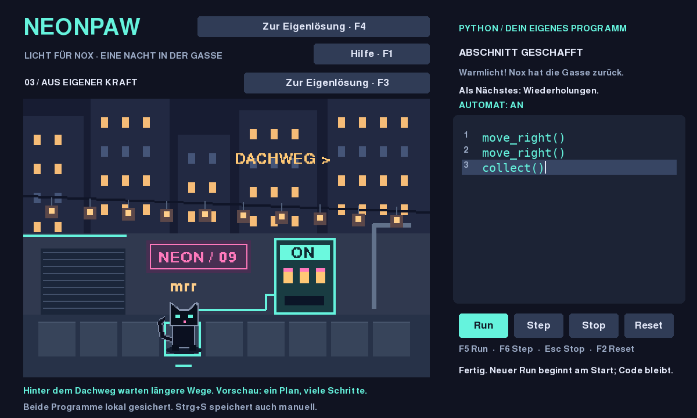

# CATWORLD / NEONPAW — Licht für Nox

Nox sitzt vor einem dunklen Nacht-Automaten. Dein Programm bringt das Licht zurück.
Ein kurzer Abschnitt: beobachten, selbst ergänzen, den zweiten Anschluss lösen und
den eigenen Plan ohne Vorlage schreiben.
`move_right()` bewegt die Katze genau ein Feld nach rechts.
`move_left()` geht ein Feld zurück: Ein Umweg kann im eigenen Programm korrigiert werden.
`collect()` nimmt die Batterie auf dem Leuchtfeld auf und schaltet den verbundenen Automaten ein.



## Start (Python 3.12 oder neuer)

**Erster Spielertest:** [10-Minuten-Test und separater Test-Spielstand](PLAYER_TEST.md).
Unter Windows dafür `player_test_windows.bat` verwenden.

Windows: Python von python.org installieren (Python zum PATH hinzufügen),
diesen Projektordner entpacken und `start_windows.bat` doppelklicken.
Beim ersten Start werden pygame-ce und Testwerkzeuge installiert (Internet nötig).
Danach läuft das Spiel offline. Der Windows-Start ist dokumentiert, aber hier
nicht auf Windows ausgeführt worden.

Linux / macOS, Terminal im Projektordner:

```sh
python3 -m venv .venv
.venv/bin/python -m pip install -r requirements.txt
.venv/bin/python -m neonpaw
```

Ein grafischer Desktop ist für das Spielfenster nötig. In der Cloud wurde die
SDL-Oberfläche offscreen gerendert und über ihre Ereigniswarteschlange geprüft.

## Diesen Abschnitt ausprobieren

1. Run drücken und Nox beim ersten Schritt beobachten.
2. Eigenen Code für die Batterie ergänzen. Der Automat und die Lampenkette reagieren.
3. **Weiter / F3:** den zweiten Anschluss mit einer selbst geänderten Folge versorgen.
4. **Selbst schreiben / F4:** aus leerem Editor einen eigenen Plan bauen.
5. **Dachweg / F7:** die weiter entfernte Dachlaterne erreichen. Erst bekannte Schritte
   ausprobieren; nach erlebter Wiederholung bietet F1 freiwillige Hilfe zu `for`/`range`.
   Schreibe deinen Plan selbst. Zurück / F7 erhält deinen bisherigen Entwurf.
6. **Nächste Laterne / F8:** nach Dach-Erfolg den eigenen Plan an das fernere Ziel anpassen.
7. **Zwei Laternen / F9:** nach Dachtransfer-Erfolg aus leerem Editor beide Lichter
   mit einem Programm verbinden. Du bestimmst die Reihenfolge; auch erst zur fernen
   Laterne und dann zurück ist gültig. Eine Aktivierung allein ist nur ein Teilerfolg.
   Bewegung und `collect()` reichen; mehrere Programme sind gültig. F9 kehrt zur
   bisherigen Eigenlösung zurück. Alle fünf Entwürfe bleiben auch nach Neustart erhalten.
8. **Freiwilliger Heimweg:** Erweitere deinen Zwei-Laternen-Plan so, dass Nox anschließend
   zum Start zurückkehrt. `move_left()` ermöglicht Rückwege; die Lichter bleiben an.
   Der bisherige Zwei-Laternen-Erfolg bleibt auch ohne diesen Bonus gültig.
9. **Werkstatt / F10:** Nach dem Laternenpaar öffnet sich ein neuer Abschnitt mit
   eigenem leerem Editor. Ein Tor versperrt den Weg zur Batterie. Auf dem sichtbaren
   Schalterfeld öffnet oder schliesst `toggle()` das Tor. Verbinde Schalter, Bewegung
   und `collect()` zu deinem eigenen Ablauf. Freiwillig: Werkstatt versorgen,
   zurückkehren, Tor schliessen und Nox heimbringen. F10 kehrt zu den Laternen
   zurück; alle sechs Programme bleiben erhalten. F1 hilft nur auf Wunsch.
10. **Starttor / F11:** In der Werkstatt kannst du einen neuen Versuch mit anfangs
    offenem statt geschlossenem Tor beginnen. Dein Code bleibt stehen. Beobachte,
    was `toggle()` jetzt bewirkt, und passe deinen Plan selbst an. Run und Reset
    verwenden den gewählten Anfangszustand; auch nach Neustart bleibt die Auswahl.
11. **Ein Plan für beide Starts:** `gate_open()` liest den aktuellen Torzustand.
    Mit `if not gate_open():` kannst du auf dem Schalterfeld nur dann `toggle()`
    ausführen, wenn das Tor noch zu ist. Die eingerückten Aktionen werden sonst
    übersprungen. F1 erklärt dies auf Wunsch; dein Programm wird nie automatisch
    ersetzt. Unter dem Editor siehst du das Ergebnis der letzten Bedingungsprüfung.
    Übersprungene Aktionszeilen erscheinen grau mit einem Strich neben der
    Zeilennummer. Das ist die Spur des letzten Versuchs; Editieren, Undo und Reset
    löschen sie. Eine Bedingung und Aktion auf derselben Textzeile werden nicht
    komplett ausgegraut, weil die Bedingung dort tatsächlich geprüft wurde.
12. **Plan prüfen / F12:** Prüfe freiwillig deinen aktuellen Werkstattcode gegen
    beide Anfangszustände. Der Vergleich zeigt Versorgung, Aktionszahl oder die
    konkrete Fehlerzeile. Ein späterer Programmfehler zählt auch nach Versorgung
    als unvollständiger Versuch. Die laufende Ausführung pausiert; Welt und eigener
    Text bleiben erhalten. Run setzt fort, Editieren/Undo verwerfen alte Ergebnisse.
    Die Prüfung verändert keine Freischaltungen und beweist nur diese zwei Fälle.

Hilfen bleiben freiwillig. Tippfehler wie `move_rigth()` geben einen konkreten Hinweis,
ändern den Text aber nicht. Nox bewegt sich animiert, blinzelt und reagiert auf Erfolg;
die Simulation bleibt unabhängig von diesen Darstellungsdetails.

## Spielen

- **Run / F5:** führt deinen Code aus, ein Befehl alle 0,45 Sekunden.
- **Step / F6:** führt höchstens einen Weltbefehl aus; unterbricht laufenden Run.
- **Stop / Esc:** verwirft die laufende Ausführung, Position und Code bleiben.
- **Reset / F2:** setzt das aktuelle Szenario und die Ausführung zurück; dein Code bleibt erhalten.
- **Hilfe / F1:** optional Beobachtung → Denkhinweis → ausdrücklich angefordertes Codebeispiel.
  Hinweise und vollständige Welt stehen gleichzeitig übereinander; beim Schließen
  wird die Welt wieder groß. Codefeld und Buttons bleiben an ihren Positionen.
- **Weiter / Freier Einstieg / F3:** wechselt zwischen Einstieg und Transfer; Code bleibt erhalten.
- **Strg+Z:** Änderung rückgängig; **Strg+Y / Strg+Shift+Z:** wiederholen.
  Je Entwurf höchstens 32 Schritte innerhalb der Sitzung. Editorwechsel erhält die
  Historie; Neustart erhält den gespeicherten Text, nicht die Historie. Undo/Redo
  stoppt laufenden Code. Neue Änderungen verwerfen den Redo-Zweig.
- Klicke ins Codefeld. Pfeile, Home/End, Enter, Backspace/Delete und Strg+A funktionieren.
- In **allen Aufgaben**, auch im Einstieg, beginnt jeder neue Versuch (Run oder Step nach Ende, Stop,
  Fehler oder Editieren) am Szenariostart. Step pausiert nach einem Befehl; Run setzt
  einen pausierten Versuch fort. Unveränderter Code gewinnt nicht durch mehrfache Runs.
- Ein Edit stoppt die Ausführung. Der nächste Run prüft den gesamten neuen Code.

Ziel: Strom für die Gasse. Starte mit dem vorgegebenen `move_right()`. Auf dem
Leuchtfeld erklärt das Spiel den nächsten Befehl. Ergänze selbst eine zweite Zeile:

```python
move_right()
collect()
```

Drücke **Run**, um das ergänzte Programm ab Start auszuführen; ein vorheriges Reset ist nicht nötig.
Die Batterie verschwindet; Kabel und Automat leuchten. Step zeigt den Unterschied
zwischen Bewegen und Aufnehmen einzeln. Ein collect am falschen Ort oder nach dem
Aufnehmen erklärt den Fehler; Reset stellt Batterie und Automaten wieder her.
Am Ende der Gasse bleibt die Bewegung sicher begrenzt.

Die unterstützte Python-Teilmenge umfasst parameterlose `move_right()`-, `move_left()`-, `collect()`- und `toggle()`-Aufrufe, Kommentare,
Leerzeilen und Python-Anweisungssequenzen sowie begrenzte `for name in range(...)`-Schleifen.
`range` akzeptiert ein bis drei ganzzahlige Literale von -64 bis 64; Schrittweite null
ist ungültig. Höchstens 64 Schleifendurchläufe insgesamt und 64 ausgeführte Aktionen.
Zusätzlich sind `if gate_open():` und `if not gate_open():` auf oberster Ebene
erlaubt; ihr eingerückter Körper enthält Weltaufrufe. Die Bedingung liest den
Weltzustand beim Erreichen der Zeile, nicht beim Laden des Programms. Kein
`else`/`elif`, keine verschachtelten Schleifen/Bedingungen, Variablenverwendung
oder weiteren Python-Funktionen. Auch übersprungene Zweige werden vorab geprüft.
`toggle()` wirkt nur auf dem Schalterfeld der Werkstatt. Das geschlossene Tor
blockiert in beiden Richtungen; ein Fehler hält vor dem Tor und markiert die Codezeile.
Step führt höchstens eine Weltaktion aus und überspringt nicht zutreffende
Bedingungszweige; ein abschliessender falscher Zweig kann ohne Weltaktion enden.
Run setzt pausierte Versuche fort.
Enter übernimmt die Einrückung, Tab/Shift+Tab rückt ein/aus. Kein vollständiger Python-Interpreter.

## Vom Vormachen zum eigenen Programm

Der erste vorgegebene Befehl zeigt nur die Bedienung. Nach dem Batterie-Erfolg führt
**Weiter: neuer Weg** zu einer Batterie, die ein Feld weiter liegt. Dein bisheriger
Code reist mit; er wird nicht automatisch angepasst. Beobachte das Ziel und ändere
selbst die Befehlsfolge. Erfahrene Spieler können mit **Freier Einstieg** sofort
zur Transferaufgabe wechseln. Beide Szenarien verwenden dieselbe Simulation.

Hilfe erscheint ausschliesslich auf Klick. Nach zwei Tipps steht auf dem Button
**Beispiel anzeigen**. Erst dieser weitere Klick zeigt Code, ohne ihn einzusetzen
oder auszuführen. Solche Versuche werden als „mit Codebeispiel“ gekennzeichnet;
Reset löscht diese Kennzeichnung nicht. Sie ist nur eine Sitzungsanzeige, kein
Lernnachweis oder dauerhaftes Profil.

## Selbst aufbauen — ohne Vorlage

Nach einem erfolgreichen Transfer erscheint **Selbst schreiben / F4**.
Der bekannte Auftrag startet mit leerem Editor. Schreibe die Folge selbst;
die drei Hilfestufen bleiben optional. Deine bisherige Eigenlösung wartet unter
**Zur Eigenlösung / F4** (auch F3). Auch ein unfertiger Abrufentwurf bleibt beim
Zurückwechseln erhalten. Reset setzt nur die Welt zurück, nicht deinen Text.

Beim Wechsel innerhalb der Sitzung bleiben beide Texte, Cursor und Hilfestatus
erhalten. Beide Texte sowie der getrennte Dachweg-Entwurf und verwendete Beispiele werden zusätzlich
lokal gespeichert und nach einem Spielneustart wiederhergestellt. Die Welt startet
am Anfang; geladener Code läuft erst nach Run oder Step.
Ein leeres Programm schaltet den Automaten nicht ein. Erfolg zeigt die Weltreaktion,
beweist aber nicht, dass der Spieler die Reihenfolge selbst verstanden hat.

Auch der Werkstattentwurf und seine Freischaltung werden lokal gespeichert.
Speicherformat 6 lädt frühere Formate 1–5 weiter; geladener Code startet niemals von selbst.

## Eigene Programme bleiben erhalten

Das Spiel speichert geänderte Entwürfe automatisch. **Strg+S** speichert zusätzlich
manuell oder versucht es nach einem Schreibfehler erneut. Die Meldung unten zeigt,
ob das Speichern funktioniert hat. Bei Speicherfehlern bleibt der Code im Editor;
vor dem Schliessen die Meldung beachten.

Standardort: Windows `%LOCALAPPDATA%\.neonpaw\drafts.json`, Linux/macOS
`~/.neonpaw/drafts.json`. Die letzte gültige Fassung liegt daneben als `drafts.bak`.
Bei beschädigter Hauptdatei wird eine gültige Sicherung geladen und dies angezeigt.
Ohne gültige Sicherung bleibt die Datei unangetastet; **Strg+S** speichert auf
Wunsch einen neuen Entwurf und erhält die beschädigte Datei als `drafts.damaged-*`.
Kein Cloud-Upload, keine Ausführung geladener Texte, keine Speicherung von Weltpositionen.

Für portable oder eingeschränkte Umgebungen kann `NEONPAW_DATA_DIR` auf einen
beschreibbaren Ordner gesetzt werden. Tests/Smoke verwenden ausschliesslich temporäre
Dateien und überschreiben keine persönlichen Programme.

## Nachweise

```sh
.venv/bin/python -m pytest -q
SDL_VIDEODRIVER=offscreen SDL_AUDIODRIVER=dummy .venv/bin/python -m tests.smoke_app
```

Windows-Tests: `.venv\Scripts\python.exe -m pytest -q`.
RED/GREEN/Refactor-Ausgaben und Bilder stehen in `evidence/`.
Automatisierte Prüfungen sind kein menschlicher Bedienbarkeits- oder Spielspassnachweis.
Siehe `CURRENT.md`, `SAFETY_AND_EXECUTION.md` und `G0_SECURITY.md`.

Langfristige Vorgaben: `PRODUCT.md`, `LONG_TERM_DESIGN.md`, `TUTORIAL_SYSTEM.md`.
G0 ist technisch abgeschlossen; dieser Build verbindet Batterie, Transfer und Abruf zu einem kleinen Abschnitt mit sichtbarem Abschluss. Keine Stadt-, Flotten- oder Cloud-Spielsysteme.

## Kurzer Spieltest: eigener Hin- und Rückweg (noch nicht menschlich validiert)

Nach dem Zwei-Laternen-Erfolg, ohne Codebeispiel:
1. Erkläre vor Step, wohin Nox als Nächstes geht und welche Laterne danach leuchtet.
2. Erweitere deinen eigenen Plan um den Heimweg. Beide Lichter sollen an bleiben.
3. Baue absichtlich einen kleinen Umweg ein und korrigiere ihn im Programm ohne Reset.
4. Schließe das Spiel, öffne es erneut und prüfe, ob dein eigener Plan erhalten ist.

Beobachtungen festhalten: Wurde der Rückweg selbst gefunden? Welche Stelle war
unklar? War Step hilfreich? Wolltest du freiwillig eine andere Lösung ausprobieren?
Hilfe darf genutzt werden; verwendete Stufe notieren. Ein erfolgreicher Run allein
beweist kein Verständnis. Keine vorab gezeigte Musterlösung und keine Spaßbehauptung.
