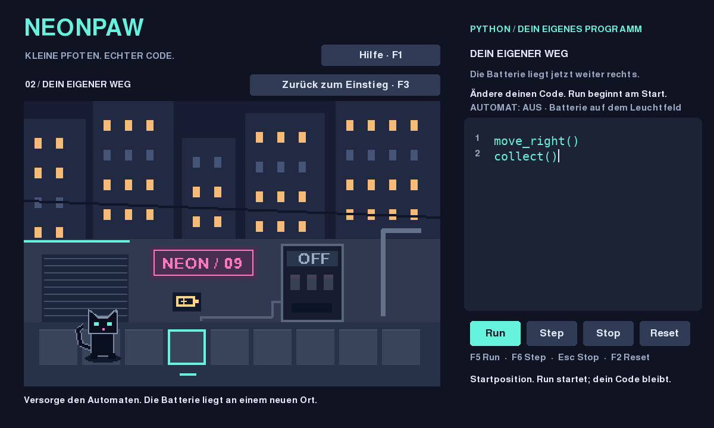

# CATWORLD / NEONPAW — Dein eigener Weg

Eine schwarze Pixelkatze, eine Neon-Gasse, dein erster Python-Befehl.
`move_right()` bewegt die Katze genau ein Feld nach rechts.
`collect()` nimmt die Batterie auf dem Leuchtfeld auf und schaltet den verbundenen Automaten ein.



## Start (Python 3.12 oder neuer)

Windows: Python von python.org installieren (Python zum PATH hinzufügen),
diesen Projektordner entpacken und `start_windows.bat` doppelklicken.
Beim ersten Start werden pygame-ce und Testwerkzeuge installiert (Internet nötig).
Danach läuft das Spiel offline. Der Windows-Start ist dokumentiert, aber hier
nicht auf Windows ausgeführt worden.

Linux / macOS, Terminal im Projektordner:

```sh
python3 -m venv .venv
.venv/bin/python -m pip install -r requirements.txt
.venv/bin/python -m neonpaw
```

Ein grafischer Desktop ist für das Spielfenster nötig. In der Cloud wurde die
SDL-Oberfläche offscreen gerendert und über ihre Ereigniswarteschlange geprüft.

## Spielen

- **Run / F5:** führt deinen Code aus, ein Befehl alle 0,45 Sekunden.
- **Step / F6:** führt genau einen Befehl aus; unterbricht laufenden Run.
- **Stop / Esc:** verwirft die laufende Ausführung, Position und Code bleiben.
- **Reset / F2:** setzt das aktuelle Szenario und die Ausführung zurück; dein Code bleibt erhalten.
- **Hilfe / F1:** optional Beobachtung → Denkhinweis → ausdrücklich angefordertes Codebeispiel.
- **Weiter / Freier Einstieg / F3:** wechselt zwischen Einstieg und Transfer; Code bleibt erhalten.
- Klicke ins Codefeld. Pfeile, Home/End, Enter, Backspace/Delete und Strg+A funktionieren.
- Im **Einstieg** beginnt ein neuer Run nach Ende oder Stop den Code wieder von vorn,
  an der aktuellen Position. Reset bringt die Katze zum Start zurück.
- In der **Transferaufgabe** beginnt jeder neue Versuch (Run oder Step nach Ende, Stop,
  Fehler oder Editieren) am Szenariostart. Step pausiert nach einem Befehl; Run setzt
  einen pausierten Versuch fort. Unveränderter Code gewinnt nicht durch mehrfache Runs.
- Ein Edit stoppt die Ausführung. Der nächste Run prüft den gesamten neuen Code.

Ziel: Strom für die Gasse. Starte mit dem vorgegebenen `move_right()`. Auf dem
Leuchtfeld erklärt das Spiel den nächsten Befehl. Ergänze selbst eine zweite Zeile:

```python
move_right()
collect()
```

Drücke **Reset**, dann **Run**, um das ganze Programm ab Start auszuführen.
Die Batterie verschwindet; Kabel und Automat leuchten. Step zeigt den Unterschied
zwischen Bewegen und Aufnehmen einzeln. Ein collect am falschen Ort oder nach dem
Aufnehmen erklärt den Fehler; Reset stellt Batterie und Automaten wieder her.
Am Ende der Gasse bleibt die Bewegung sicher begrenzt.

Die unterstützte Python-Teilmenge umfasst parameterlose `move_right()`- und `collect()`-Aufrufe, Kommentare,
Leerzeilen und Python-Anweisungssequenzen. Schleifen und andere Python-Funktionen
sind noch nicht freigeschaltet. Kein vollständiger Python-Interpreter.

## Vom Vormachen zum eigenen Programm

Der erste vorgegebene Befehl zeigt nur die Bedienung. Nach dem Batterie-Erfolg führt
**Weiter: neuer Weg** zu einer Batterie, die ein Feld weiter liegt. Dein bisheriger
Code reist mit; er wird nicht automatisch angepasst. Beobachte das Ziel und ändere
selbst die Befehlsfolge. Erfahrene Spieler können mit **Freier Einstieg** sofort
zur Transferaufgabe wechseln. Beide Szenarien verwenden dieselbe Simulation.

Hilfe erscheint ausschliesslich auf Klick. Nach zwei Tipps steht auf dem Button
**Beispiel anzeigen**. Erst dieser weitere Klick zeigt Code, ohne ihn einzusetzen
oder auszuführen. Solche Versuche werden als „mit Codebeispiel“ gekennzeichnet;
Reset löscht diese Kennzeichnung nicht. Sie ist nur eine Sitzungsanzeige, kein
Lernnachweis oder dauerhaftes Profil.

## Nachweise

```sh
.venv/bin/python -m pytest -q
SDL_VIDEODRIVER=offscreen SDL_AUDIODRIVER=dummy .venv/bin/python -m tests.smoke_app
```

Windows-Tests: `.venv\Scripts\python.exe -m pytest -q`.
RED/GREEN/Refactor-Ausgaben und Bilder stehen in `evidence/`.
Automatisierte Prüfungen sind kein menschlicher Bedienbarkeits- oder Spielspassnachweis.
Siehe `CURRENT.md`, `SAFETY_AND_EXECUTION.md` und `G0_SECURITY.md`.

Langfristige Vorgaben: `PRODUCT.md`, `LONG_TERM_DESIGN.md`, `TUTORIAL_SYSTEM.md`.
G0 ist technisch abgeschlossen; dieser Build ergänzt den G1-Batterie-Loop um genau eine Transferaufgabe und optionale Hilfen. Keine Stadt-, Flotten- oder Cloud-Spielsysteme.
