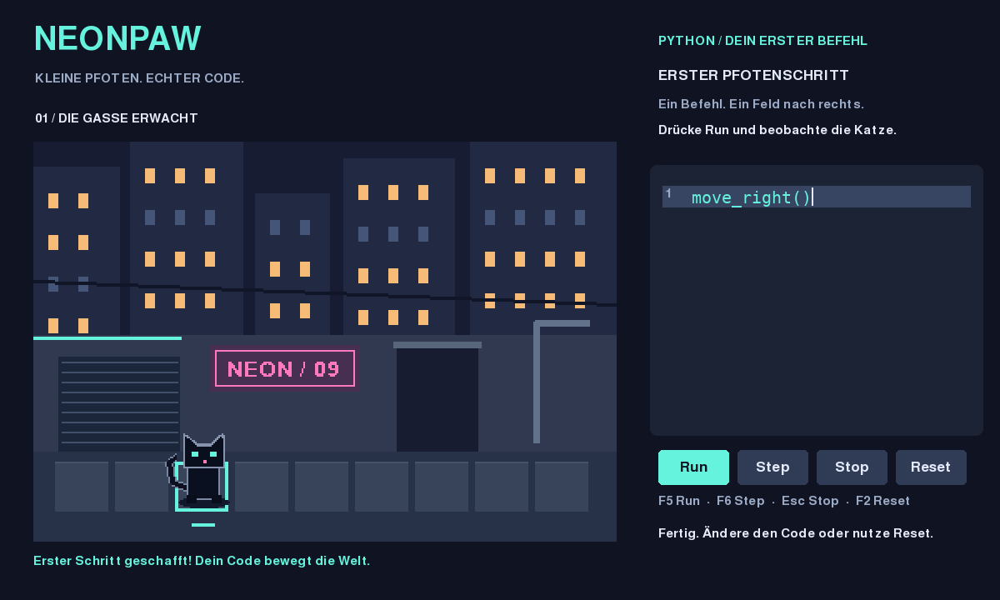

# CATWORLD / NEONPAW — G0

Eine schwarze Pixelkatze, eine Neon-Gasse, dein erster Python-Befehl.
`move_right()` bewegt die Katze genau ein Feld nach rechts.



## Start (Python 3.12 oder neuer)

Windows: Python von python.org installieren (Python zum PATH hinzufügen),
diesen Projektordner entpacken und `start_windows.bat` doppelklicken.
Beim ersten Start werden pygame-ce und Testwerkzeuge installiert (Internet nötig).
Danach läuft das Spiel offline. Der Windows-Start ist dokumentiert, aber hier
nicht auf Windows ausgeführt worden.

Linux / macOS, Terminal im Projektordner:

```sh
python3 -m venv .venv
.venv/bin/python -m pip install -r requirements.txt
.venv/bin/python -m neonpaw
```

Ein grafischer Desktop ist für das Spielfenster nötig. In der Cloud wurde die
SDL-Oberfläche offscreen gerendert und über ihre Ereigniswarteschlange geprüft.

## Spielen

- **Run / F5:** führt deinen Code aus, ein Befehl alle 0,45 Sekunden.
- **Step / F6:** führt genau einen Befehl aus; unterbricht laufenden Run.
- **Stop / Esc:** verwirft die laufende Ausführung, Position und Code bleiben.
- **Reset / F2:** setzt Welt und Ausführung zurück; dein Code bleibt erhalten.
- Klicke ins Codefeld. Pfeile, Home/End, Enter, Backspace/Delete und Strg+A funktionieren.
- Ein neuer Run nach Programmende oder Stop beginnt den Code wieder von vorn,
  an der aktuellen Position. Reset bringt die Katze zum Start zurück.
- Ein Edit stoppt die Ausführung. Der nächste Run prüft den gesamten neuen Code.

Ziel: das leuchtende Feld erreichen. Danach kannst du mehrere `move_right()`-Zeilen
probieren. Am Ende der Gasse gibt es eine verständliche Fehlermeldung.

G0 unterstützt ausschliesslich parameterlose `move_right()`-Aufrufe, Kommentare,
Leerzeilen und Python-Anweisungssequenzen. Schleifen und andere Python-Funktionen
sind noch nicht freigeschaltet. Kein vollständiger Python-Interpreter.

## Nachweise

```sh
.venv/bin/python -m pytest -q
SDL_VIDEODRIVER=offscreen SDL_AUDIODRIVER=dummy .venv/bin/python -m tests.smoke_app
```

Windows-Tests: `.venv\Scripts\python.exe -m pytest -q`.
RED/GREEN/Refactor-Ausgaben und Bilder stehen in `evidence/`.
Automatisierte Prüfungen sind kein menschlicher Bedienbarkeits- oder Spielspassnachweis.
Siehe `CURRENT.md`, `SAFETY_AND_EXECUTION.md` und `G0_SECURITY.md`.

Langfristige Vorgaben: `PRODUCT.md`, `LONG_TERM_DESIGN.md`, `TUTORIAL_SYSTEM.md`.
Aktiver Umfang bleibt G0; keine Stadt-, Flotten- oder Cloud-Spielsysteme.
