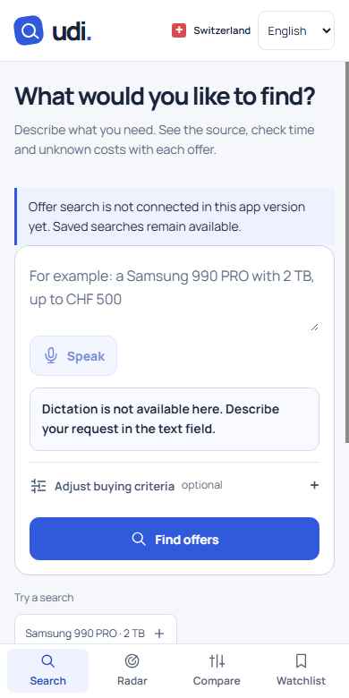
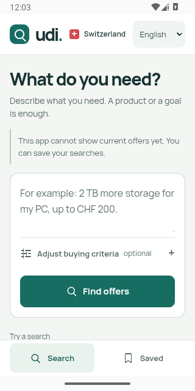
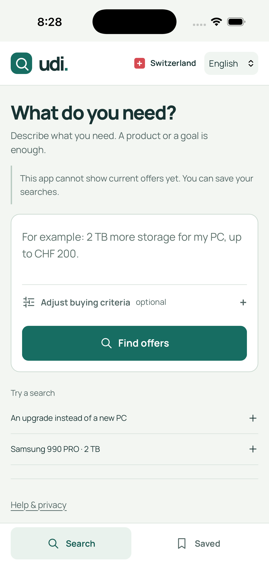

# Zieleingabe und gespeicherte Suchen · 24.11.2026

Neue direkte Sprachwahl **auf Android tatsächlich geprüft**: [Originales Emulatorbild](language-actions-android-native.png),320×640, App70fece9. Vollständige PNG-Übertragung samt Hash und Bild angesehen; beide Sprachtasten, Texteingabe/Dienstfehler/Speicherung sowie beide Suchen nach Prozessneustart erfolgreich. [Getrennter nativer Nachweis](../2026-11-24-language-android-70fece9.json). iOS, reale native Angebote und Spracheingabe bleiben gesondert abzunehmen; Bild ist kein Kaufangebot.

Spätere Sprachwahlkorrektur70fece9: [390px](language-actions-browser-390.png) und [320px](language-actions-browser-320.png) zeigen direkte Deutsch-/English-Tasten in der tatsächlich laufenden Browser-QA. Beide Bilder angesehen; klare44px-Aktionen statt zusätzlichem Systempicker, laufende Texteingabe bleibt erhalten. **Keine nativen Bilder oder neue iOS-Abnahme.** [Prüf-/Wiederherstellungsnachweis](../2026-11-24-language-ui-70fece9.json). Die folgenden früheren Vorher-/Nachher- und echten nativen Nachweise bleiben unverändert historisch erhalten.

Die folgenden Vorher-/Nachher-Bilder zeigen die laufende gemeinsame App-Oberfläche in Chromium mit einem ausdrücklich simulierten Android-Brückenadapter. **Diese drei Vergleichsbilder sind keine nativen Gerätebilder und keine Geräteabnahme.** Der gespeicherte Samsung-Wunsch ist eine synthetische QA-Eingabe, kein Angebot und kein Kunde. Der separate echte Android-Nachweis steht weiter unten.

Vorher und nachher: Englisch, 390 × 780 Pixel. Der frühere Build zeigte eine deaktivierte Spracheingabe samt Fehlerfläche. Der neue Einstieg priorisiert Zieleingabe, Hauptaktion und gespeicherte Wünsche; Radar-/Vergleichsrouten bleiben kontextuell erhalten. Aktuelle Angebote und native Sprache sind weiterhin nicht verfügbar und werden nicht als funktionierend ausgegeben.

| Laufende Browser-QA | Vorher | Nachher |
|---|---:|---:|
| Oberkante Suchknopf | 578,23 px | 426,88 px |
| Höhe des Suchknopfs | 48 px | 52 px |
| Höhe des Eingabebereichs | 369,28 px | 236,72 px |
| Höhe der Navigation | 61,16 px | 60,19 px |

Die Werte sind Layoutmessungen dieser Ansicht, keine Nutzerbewertung. Zusätzlich DE/EN bei 320 × 640 und 390 × 780 sowie 200 Prozent CSS-Text geprüft. Systemschriftgrösse und Screenreader auf Geräten sind damit nicht abgenommen. Ausgewählte native Farbpaare: Text 12,35:1, sekundärer Text 5,60:1, Hauptaktion 6,18:1 und aktive Navigation 7,05:1; keine pauschale Barrierefreiheitszusage.

Vorher:

Nachher:

Gespeicherte Suche:

Der [Bewertungsbogen](../../PILOT-TEST.md) ist unausgefüllt. Wertigkeit, Verständnis und Wiederkehr müssen echte Testpersonen beurteilen. Live-Dienst, vollständiger Nutzerablauf und tatsächlich übergebbare Binärpakete bleiben eigene P0-Abnahmen.

## Tatsächlich installierte Android-App

Quellstand9c2af2f85c8d, API36, 320×640. [Job138108069864](https://github.com/essenmitpassion-sudo/Catworld/actions/runs/45293534923/job/138108069864) hat Installation, Start, EN/DE-Texteingabe, den realen fehlenden Dienst sowie Speichern und exaktes Wiederfinden beider Wünsche nach Prozessneustart bestanden. Das Bild stammt vom Emulator über adb, nicht von Chromium. SHA-256 und Prüfumfang: [unveränderter Nachweis](../2026-11-24-android-ui-9c2af2f85c8d.json).

Suchknopf und Navigation sind vollständig sichtbar; die ehrliche Dienstlücke bleibt lesbar. Kein Nachweis für physische Geräte, Live-Angebote, Spracheingabe, Systemschrift oder Screenreader. iOS hat eine getrennte Abnahme.

## Tatsächlicher iOS-Bildschirm nach fehlgeschlagener Bereitschaftsprüfung

Quellstand812152b, iPhone17Pro/iOS26.5, 1206×2622 Pixel. [Herkunft, Hash und genaue Grenze](../2026-11-24-ios-visual-812152b.json): XCTest startet die installierte App und erkennt den WebView; die anfängliche globale Textabfrage scheitert, obwohl der spätere Zugänglichkeitsbaum den Text enthält. Das nach Testende tatsächlich aufgenommene Bild wurde vollständig übertragen, hashgeprüft und angesehen. **Kein bestandener Such-/Speicher-/Neustartablauf.**

Einführung, ehrlicher Diensthinweis, Eingabe und Hauptaktion sind sichtbar, die Navigation verdeckt die Aktion nicht. Der nächste kontrollierte Test verwendet gezielt den WebView-Inhalt und protokolliert dessen anfänglichen Zugänglichkeitsbaum. Keine fehlenden Prüfungen durch das Bild ersetzen.
