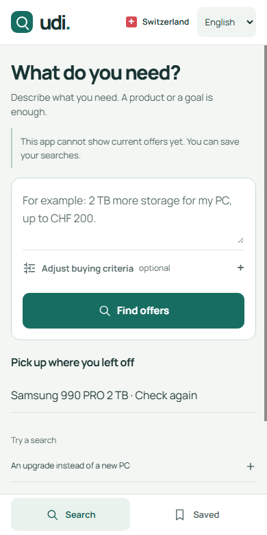
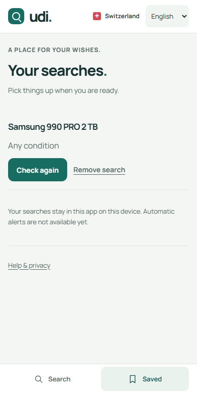

# Zieleingabe und gespeicherte Suchen · 24.11.2026

Diese Bilder zeigen die laufende gemeinsame App-Oberfläche in Chromium mit einem ausdrücklich simulierten Android-Brückenadapter. **Keine nativen Gerätebilder und keine Geräteabnahme.** Der gespeicherte Samsung-Wunsch ist eine synthetische QA-Eingabe, kein Angebot und kein Kunde. Native Nachweise bleiben separat in der Plattformmatrix.

Vorher und nachher: Englisch, 390 × 780 Pixel. Der frühere Build zeigte eine deaktivierte Spracheingabe samt Fehlerfläche. Der neue Einstieg priorisiert Zieleingabe, Hauptaktion und gespeicherte Wünsche; Radar-/Vergleichsrouten bleiben kontextuell erhalten. Aktuelle Angebote und native Sprache sind weiterhin nicht verfügbar und werden nicht als funktionierend ausgegeben.

| Laufende Browser-QA | Vorher | Nachher |
|---|---:|---:|
| Oberkante Suchknopf | 578,23 px | 426,88 px |
| Höhe des Suchknopfs | 48 px | 52 px |
| Höhe des Eingabebereichs | 369,28 px | 236,72 px |
| Höhe der Navigation | 61,16 px | 60,19 px |

Die Werte sind Layoutmessungen dieser Ansicht, keine Nutzerbewertung. Zusätzlich DE/EN bei 320 × 640 und 390 × 780 sowie 200 Prozent CSS-Text geprüft. Systemschriftgrösse und Screenreader auf Geräten sind damit nicht abgenommen. Ausgewählte native Farbpaare: Text 12,35:1, sekundärer Text 5,60:1, Hauptaktion 6,18:1 und aktive Navigation 7,05:1; keine pauschale Barrierefreiheitszusage.

Vorher:

Nachher:

Gespeicherte Suche:

Der [Bewertungsbogen](../../PILOT-TEST.md) ist unausgefüllt. Wertigkeit, Verständnis und Wiederkehr müssen echte Testpersonen beurteilen. Live-Dienst, vollständiger Nutzerablauf und tatsächlich übergebbare Binärpakete bleiben eigene P0-Abnahmen.
